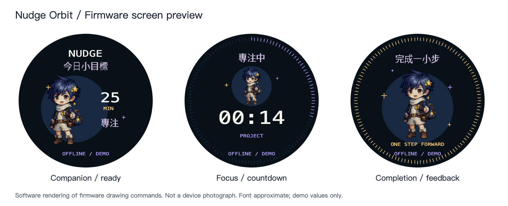

# Orbit 品牌一致性畫面驗證

日期：2026-11-23。此紀錄是軟體驗證，不是實機驗收。

## 改動

規格：[orbit-report-display](../specs/orbit-report-display.md)。

改用 App「星辰學徒」既有素材、紫色與金色星光元素、固定繁體中文字標。
覆蓋八個 Orbit 場景；主要報告畫面為 Home、Focus、Complete。
Station、Activity Ledger、Cloud 權限及硬體腳位均未變更。

## 檢查結果

- `make test`：四組 native suite 通過，包含新增的 Orbit 畫面邊界、DEMO
  標示、素材輸出與倒數局部重繪測試。
- `make report-preview preview`：從同一份 Painter 產生三場景與八場景 SVG，
  已目視檢查全部八場景，未見文字重疊或圓形裁切。
- `pio run -e orbit_p0a -e orbit_demo`：兩環境 SUCCESS；同一 XIAO ESP32S3／
  Seeed Round Display pin profile，未升級依賴。
- 已確認 RGB565 素材產生器重構前後的 generated header 沒有差異。
- 規格審查：0 findings。
- 規範審查：0 硬性違反；1 個低風險重複量化邏輯建議，已抽出 `pixel_ink`
  並重新生成確認輸出一致。

## 限制與交接

- 固定 DEMO 角色，不是玩家即時裝備同步。沒有新姿勢動畫或進化解鎖。
- 中文為固定字標子集，不能拿來顯示任意任務名稱。ASCII 預覽字型近似。
- 圖片是軟體預覽，非裝置攝影；不代表 TFT 面板方向、顏色、實際可讀性或
  傳輸延遲已通過。
- 硬體需回傳開機及十輪展示影片，檢查全部畫面、倒數與拔插電源恢復。
- 保留 `OFFLINE / DEMO`，無真實獎勵、同步、電池或時鐘宣稱。
- 編譯仍有既有 `TOUCH_CS` 未定義警告；本版不宣稱觸控可用。
- PR #65 仍依賴組員 #25；本次更新不代表已合併 main 或已部署。
