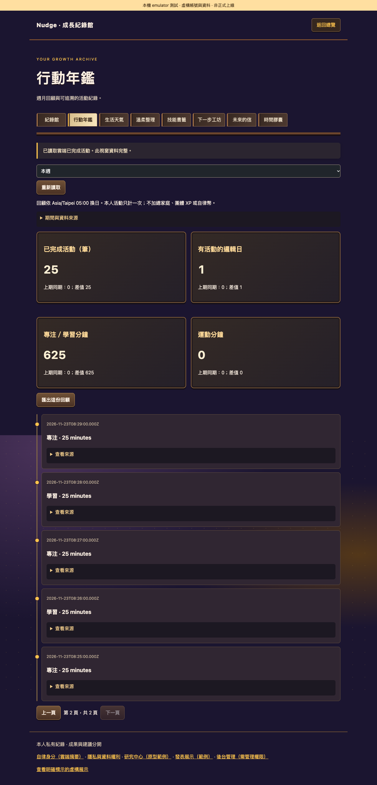
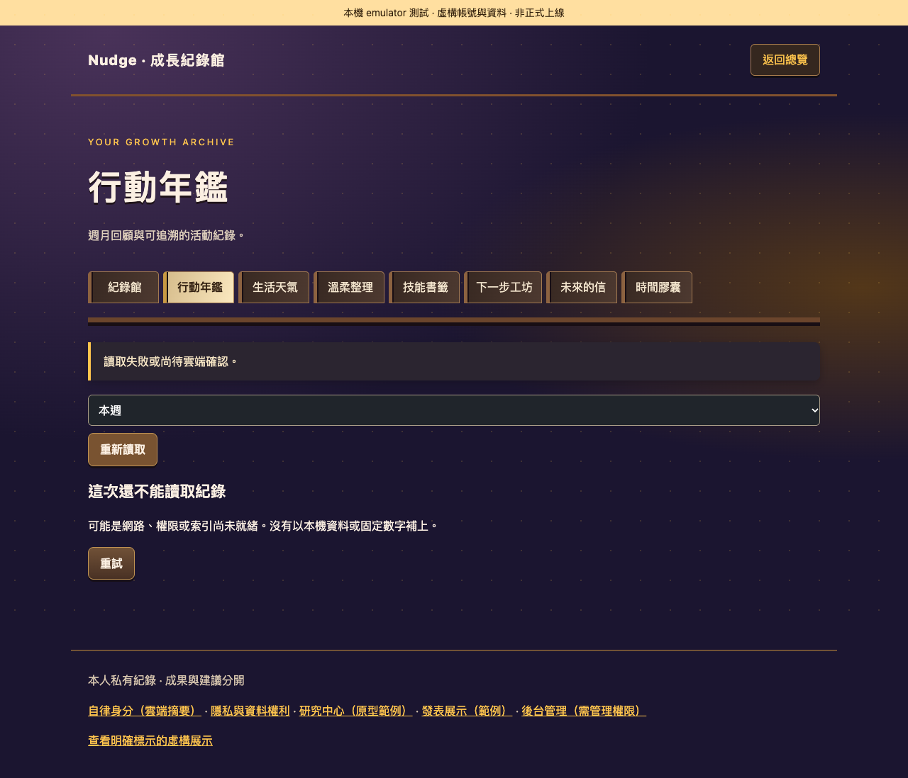

# WEB-GAME-03｜切片 2：行動時間線與週月回顧

Issue #84；2026-11-23（Asia/Taipei）。base main @ 27f1e4d，單一切片 Draft PR；不部署、不合併、不 Approve、不 force push、不推 main。

## 實作與驗收

| 驗收項 | 本輪結果 |
| --- | --- |
| 本人 Cloud-only completed sessions，文件 ID 綁 fingerprint SHA-256，不誤用 source session ID | source 已實作；本機對應測試／整合情境通過，非 production 驗收 |
| 05:00 邏輯日、週月同期比較、單位分開、同 session 不因房間數倍增 | source 已實作；本機對應測試／整合情境通過，非 production 驗收 |
| 單次完整快照上限500，超量／格式錯誤不提供完整總計或匯出，提供正式隱私匯出入口 | source 已實作；本機對應測試／整合情境通過，非 production 驗收 |
| 可翻頁、匯出、重試；快取／延遲／拒讀／登出與舊回應有清楚狀態 | source 已實作；本機對應測試／整合情境通過，非 production 驗收 |

## 自評與保留

內容 25/25、指標 30/35、驗證 21/25、交接 15/15，合計 **91/100**；至少85才上傳。
超過500筆的視窗需縮小或使用正式隱私匯出；未做 production 索引／資料驗收，仍依賴入口切片。
全部尚未驗收的 production／實機／真人項目不計成功；Issue 不關閉。

## 測試與證據

五個切片在獨立 main 分支製作，再以變更覆蓋組成本機整合目錄；沒有合併他人的 PR 或引入整個 #79／#73 分支。
瀏覽器共43項檢查：雙裝置、草稿確認／取消、存取／文字安全、未到期、改 client clock、到期／匯出／取消／刪除、舊回應帳號隔離、空資料／網路／撤權／超量、360px、鍵盤及減少動態。
八頁 axe WCAG A／AA 零違規；不是已完成人工螢幕閱讀器或實機手機驗收。實際共用 bootstrap、獨立 cache key、登入／登出也另作 smoke。
所有截圖皆為明確標示的本機 emulator 虛構資料；callable adapter 不代表 production App Check，不能拿它宣稱已部署。
修改前圖為原版靜態頁的固定數字（未載入舊 Demo 圖表程式）；修改後為五個切片合併呈現的本機畫面，不冒稱獨立 PR 未有依賴就已可上線。

完整精簡結果與檔案 hash 見 assessment.json、browser-results.json、bootstrap-smoke.json。實際 CLI 結果見 validation.json／logs。

## 依賴與回復

切片2–5 的模組由切片1入口載入；完整故事還需 #82 的世界路線契約。#73／#79 尚未合併，不假稱已進 main。Reviewer／整合與最終 merge 由 z1nnz 決定。
新增 schema／index 是加法，沒有 production migration。dry-run 僅 emulator 原始資料／權限／刪除與回復測試，apply gate 保持未執行。
回復為 revert 本切片程式與入口。不要把已保存本人文字直接刪掉；膠囊 secrets 的 deny-all 規則必須保留到封存資料按政策處理完。
既有 localStorage／users.timeCapsules 不是安全封存，不自動搬移。新膠囊只用新命名空間與 Cloud 時間。
原文件／膠囊保留到本人刪除或正式帳號刪除；取消擦除正文；刪除後無正文 tombstone 保留到帳號刪除以阻止重試恢復。已產生正式匯出檔沿七日到期，自行下載副本由本人保管；帳號正式刪除會刪除全部 Cloud 匯出物件。
