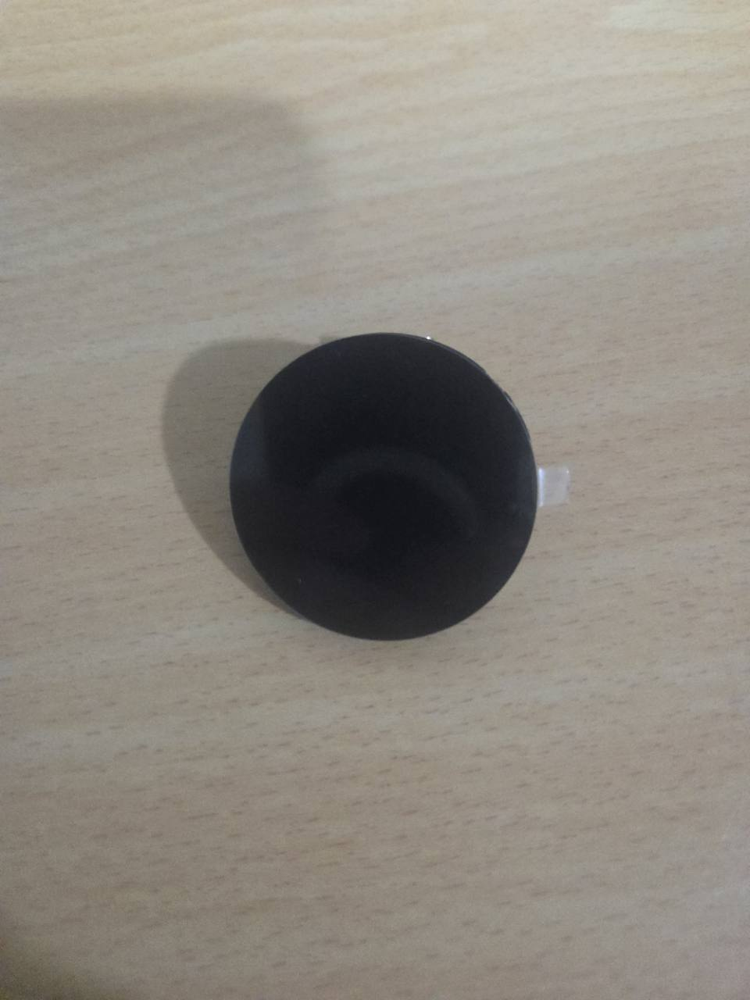
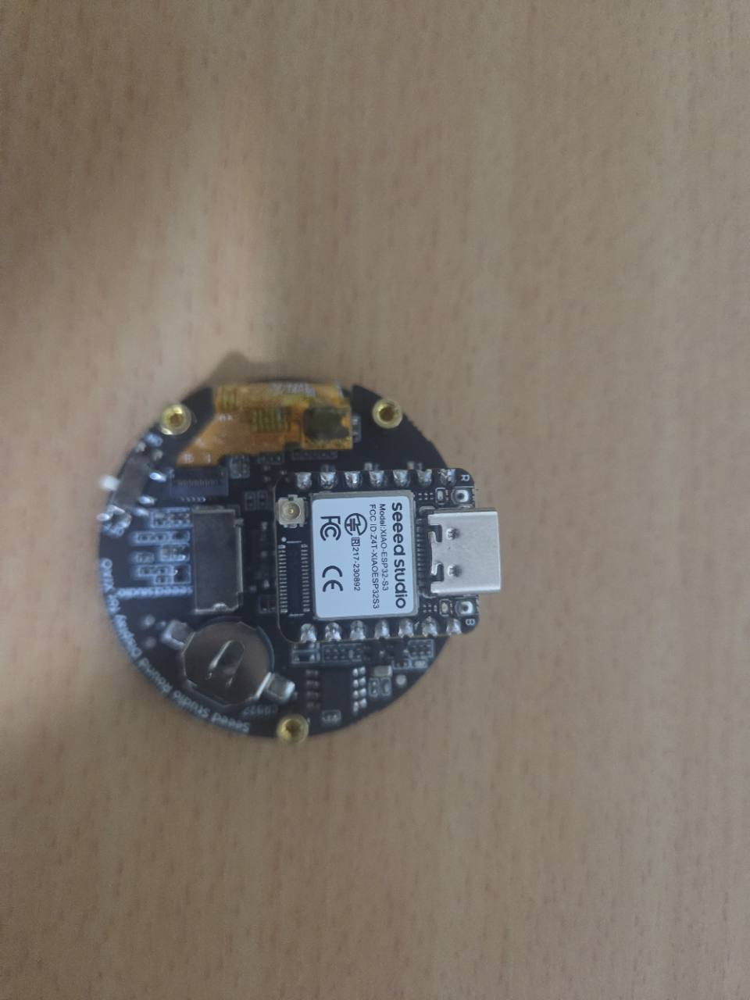

# Orbit｜開發前零件卡

日期：2026-11-14。任務：`DEMO-01`（P0-A），本卡先交付文件；USB 燒錄證據待補。
預設裝置負責：johnsnow；本次由 roy 整理既有照片，未代替裝置負責人確認功能。
範圍遵循 [package 00](https://github.com/z1nnz/graduation-project-nudge/blob/9ace911bf892dfb3a451acce7e2ecbeb41904f7d/docs/work-packages/00-scope-reset.md)。

| Package 01 必填欄位 | 已知結果 |
| --- | --- |
| 裝置 | Nudge Orbit 圓形裝置；組件 B 級，未有成功顯示證據 |
| ESP32 板上印字 | `seeed studio`、`Model: XIAO-ESP32-S3`；由清晰背面照辨識 |
| 螢幕正面照片 | [314352 原圖](evidence/orbit/2026-11-08-314352-original.jpg)，未見可辨識畫面 |
| 螢幕背面照片 | [314259 原圖](evidence/orbit/2026-11-08-314259-original.jpg)及 [314353 主控標籤](evidence/orbit/2026-11-08-314353-original.jpg) |
| 螢幕或包裝型號 | 板上 `Seeed Studio Round Display for XIAO`；精確採購 SKU 與 PCB revision 未確認 |
| 商品／原廠頁 | [Seeed Round Display 官方文件](https://wiki.seeedstudio.com/get_start_round_display/)、[XIAO ESP32S3 官方文件](https://wiki.seeedstudio.com/xiao_esp32s3_getting_started/) |
| 目前如何連接 | 歷史照片可見 XIAO 插接在圓屏背面；314259 有 USB-C 插線，314353 未插線；未重新操作或確認目前開關狀態 |
| 目前已觀察到的畫面 | 僅有顯示面外觀，無 Nudge、五色或其他可辨識像素內容；反光不算顯示成功 |
| USB 線可否成功燒錄 | 未驗證；無 upload log、port 或韌體版本，不能由插線照片推論資料能力 |
| 已購買可選周邊 | 產品內建觸控／RTC／TF 卡槽可由原廠規格核對；照片可見卡槽與電池座，功能及是否裝電池未驗證；P0-A 不依賴這些功能 |
| 不確定事項 | revision、現有開關位置、個別主控對應、USB 資料能力及實機顯示均待裝置持有人核對 |

## 原廠資料與實物證據的界線

原廠產品規格為 1.28 吋、240×240；官方 Seeed_GFX 範例選擇
`BOARD_SCREEN_COMBO 501`（GC9A01）。這些用於辨識產品系列，不代表本次已讀取
driver ID 或驗證所有板上 IC。官方列 v1.0／v1.1 差異；照片上的二位開關不足以
單獨推定實物 revision。

官方插接方向為 USB-C 朝圓屏外側；不按聊天照片的旋轉方向推算左右。
後續由持有人核對原廠示意、板上標示與開關，不拆螢幕、不硬壓玻璃，也不為本卡
新增焊接或採購。本 PR 未給新的 GPIO 或開關設定。

## 已保存原圖

三張原圖的檔名與 SHA-256 見 [manifest](evidence/manifest.json)。
收到日期為 2026-11-08；照片不等同目前的即時連接狀態。

## 下一份最小證據

裝置持有人在確認方向後，保存單機 serial port、編譯／upload log 與五色影片；
再進行三幕自動展示。使用者本次指定實機稍後驗收，因此未執行這些步驟，
`DEMO-01` 的 USB 燒錄要求與 `ORB-01` 尚未關閉。
