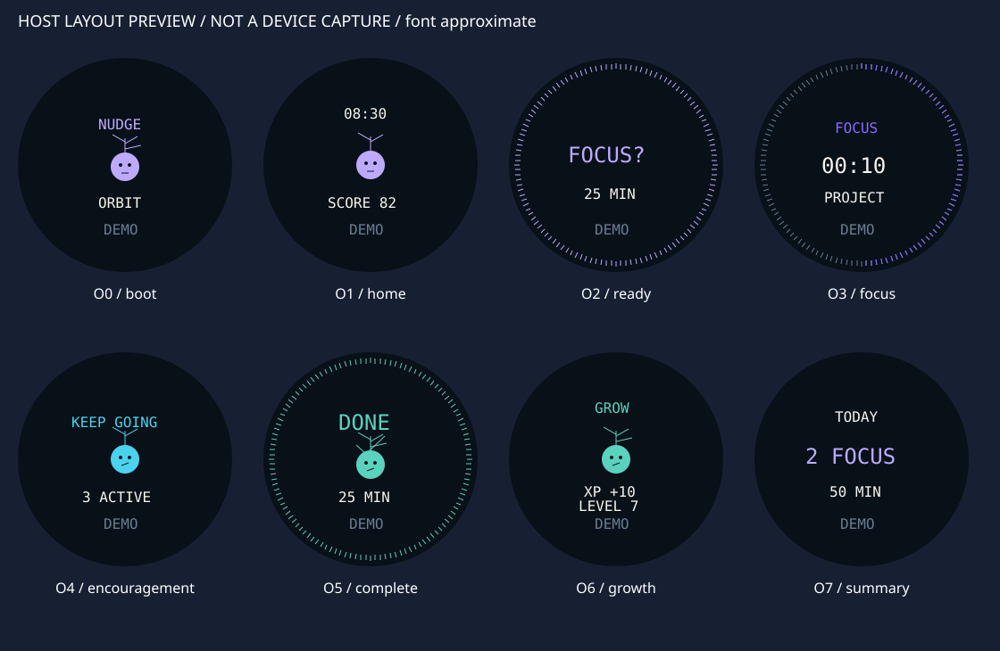

# 工作包 03／04：逐項交付與待驗

核對日期：2026-11-17。來源為 `codex/execution-work-packages` 的
`9ace911bf892dfb3a451acce7e2ecbeb41904f7d`，不是已作廢的 11/04 工作包。

## 是否已有人做過

已查 GitHub 全部 22 個 PR、全部 23 個分支、全部 Issue 及 #18 留言、最新 main 與舊韌體。
沒有新版 package03/04 的實作 PR、專屬工作分支、獨立 Issue 或完成證據。
#8／#15 是舊版正式 BLE／周邊韌體，沒有新八幕引擎，不算這兩包已完成。
#18 是新版規劃文件；#19／#20／#22 分別交付 package00／01／02。
只能確認遠端可見紀錄，不能排除別人在尚未推送的電腦上開發。

原分工預設由 johnsnow 處理共用 core／Orbit；本次使用者明確要求在無完成紀錄時先做 03／04。
本輪以獨立 `nudge_competition_demo` 專案接手軟體切片，未修改原共用 main.cpp，
未宣稱已由另一位組員確認移交。03＋04 合在一個可審查的「Orbit 離線展示」功能 PR，
沒有開始 05／06 的 Station 完整畫面或實體周邊。

## 03 指標

| 指標 | 實作／證據 | 結果 |
| --- | --- | --- |
| Scene 0–7、固定順序、Summary 回 Home | core.cpp、native 10 圈以上驗證 | 軟體通過 |
| P0-A Home／Focus／Complete | 預設 orbit_p0a、5/20/5 秒、native 10 圈 | 軟體通過 |
| next／restart／tick；previous 可選 | Runtime 與 Serial adapter，restart 優先於到期 tick | 軟體通過；未做 previous |
| 任一幕 restart 回 Boot | native 從 8 幕逐一 reset，Boot 內重設亦重新繪製 | 軟體通過 |
| 自動時間不跳過 Complete | 晚到 tick 只換一幕、完整停留；uint32 回捲測試 | 軟體通過 |
| 同一 DemoData、無真帳號／Cloud | core 唯一固定資料，ASCII 顯示別名；無 NVS／連線程式 | 原始碼核對 |
| DisplayPort／EffectPort 分離 | 失敗注入仍換幕；兩種 Painter 收到同一 Frame，產生不同版面 | native 通過 |
| 不用長 delay／等待 Serial | tick 差值，20Hz 繪圖；每次最多讀 16 字元 | 原始碼核對 |
| 無輸入 5 秒開始自動，N/R 操作 | native 邊界測試；未用未驗證按鍵／觸控 | 軟體通過，實體輸入待驗 |
| Orbit environment／driver | GC9A01 Setup501、固定 Seeed_GFX commit | 編譯驗證；尚未 upload |
| Station environment／driver | 有 station_demo，但只序列診斷、不操作 LCD | **部分：缺 Station LCD driver／可顯示 binary** |
| optional 失敗不擋畫面 | EffectPort 失敗注入；實際 P1 全略過 | 軟體通過；實體拆除測試待驗 |
| source、binary、build log、場景對照、命令 | 本專案、build-evidence、manifest、host SVG、README | 軟體交付；無實機截圖 |
| 冷啟動 3 次、upload、10 圈、Next/Restart 各 10 次 | 操作者稍後接板並錄影 | **未驗，0 實機通過** |
| 兩台實機影片 | evidence.json 路徑／hash 為 null | **未完成** |

## 04 開發切片與驗收

| 切片／指標 | 本輪成果 | 實機狀態 |
| --- | --- | --- |
| ORB-01 最小顯示 | orbit_colors 五色、原廠配置 | 全圓、白屏、插接方向、10 秒影片未驗 |
| ORB-02 字型／安全區 | 校正模式、rotation 0、8/16/24px 參考與中央 70% 設計 | 實際方向／色序、30–50cm 可讀性未驗 |
| ORB-03 P0-A 三幕 | Home／Focus／Complete 自動，預設 environment | 冷啟動 3 次、3 圈、斷網顯示未驗 |
| ORB-04 P0-B 八幕 | O0–O7 畫面、Serial N 切換、固定 DEMO | 破圖／殘影／記憶體未驗 |
| ORB-05 場景引擎 | 共用 core、N／R、自動 10 圈 host 測試、20 秒 Focus | 10 圈及 Next／Restart 各 10 次未驗 |
| ORB-06 動畫 | Boot 兩階亮度／展葉、增量進度環、Complete 兩階角色／勾選；static fallback | 不是平滑 alpha 淡入；Ready 無呼吸，閃爍／流暢性未驗 |
| ORB-07 輸入 | 已有 Serial N/R；無可靠輸入仍自動播放 | 觸控／實體短長按未實作，列 P1 待驗 |
| binary／source／build log／命令／備援 | 六種編譯輸出、hash manifest、build log、重刷命令、退回三幕說明 | 未建立已實測備援 binary 名單 |
| 完整影片／近拍／插接方向照片 | evidence.json 待補欄位 | **未完成，0 實機通過** |

## 實機稍後驗收的操作清單

所有核取方塊保留未勾，不能用 host 10 圈代替板上 10 圈。

- [ ] 確認兩個獨立裝置、Orbit 型號／插接方向，保存現場照片。
- [ ] Orbit 五色每次覆蓋全圓，記錄 rotation／色序，保存 10 秒影片。
- [ ] 校正模式在 30–50cm 可讀，沒有裁切／方向錯誤。
- [ ] 上傳 orbit_p0a；USB 冷啟動三次，10 秒內 Home，連續三圈，手機／網路關閉。
- [ ] 上傳 orbit_demo；連續十圈，記錄完整版本／每圈秒數與畫面。
- [ ] Serial Next 十次、Restart 十次，從任一幕回 Boot 再回 Home。
- [ ] 所有 P1 周邊移除仍可三幕；有閃爍可改 static 或退回 p0a。
- [ ] 補近拍／完整影片、操作紀錄及 SHA-256；核對 binary 與 source commit。
- [ ] 重排 package02 三分鐘腳本（Ready 3s／Summary 8s），實際真人計時。
- [ ] Station 另確認獨立主控、接線與 driver，再完成工作包 05／實機驗收。

## 圖像證據的範圍

此圖由韌體共用 Painter 輸出 SVG，人工檢視 8 幕、標籤／DEMO、圓形安全區與顏色。
SVG 字型以 monospace 近似，只證明軟體版面；不是實機照片、實際字形／色彩校準或驅動驗證。
可用 `make -C firmware/nudge_competition_demo preview` 重建。

## 驗證與評分

詳見[自評](self-review.md)；85 是「可送審軟體切片」門檻，完整硬體工作包仍未驗收。
本輪六種本機 build、native／root 測試及最新 PR CI 必須通過才交接；CI run 與 head 在 PR 記錄。
目前憑證無 workflow 修改權限，本 PR 保留原 CI。六種 ESP32 編譯由本機交付 binary／log／manifest，
現有 Web CI 仍會實際編譯執行新的 C++ native 測試；不宣稱 CI 有 ESP32 交叉編譯。
未採購、未改接線、未開啟 BLE、未發送團隊公告，也未自行合併。
