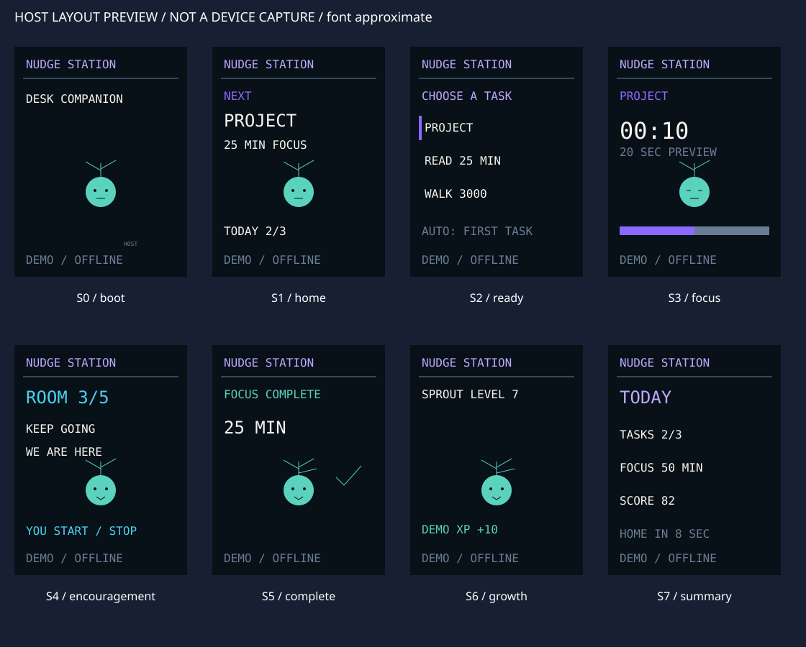

# 工作包 05／06：Station 展示與既有周邊軟體交付

日期：2026-11-17。範圍遵循新版
[00](https://github.com/z1nnz/graduation-project-nudge/blob/9ace911bf892dfb3a451acce7e2ecbeb41904f7d/docs/work-packages/00-scope-reset.md)、
[05 Station](https://github.com/z1nnz/graduation-project-nudge/blob/9ace911bf892dfb3a451acce7e2ecbeb41904f7d/docs/work-packages/05-station-square-display-work-package.md)、
[06 P1](https://github.com/z1nnz/graduation-project-nudge/blob/9ace911bf892dfb3a451acce7e2ecbeb41904f7d/docs/work-packages/06-existing-input-led-sensor-work-package.md)。

交付的是可重建與送審的軟體；**實機稍後驗收，未宣稱 Station 已成功顯示或 P1 已啟用**。
Station 有實際 ST7789 adapter／八幕，發布設定沒有 GPIO，會先回報未確認而不操作 LCD。
06 先準備可失敗的 driver／host 邏輯，兩台 P0-A 實機通過前全部停用。本輪決定不將任何 P1 納入比賽預設版本。

## 開始前查重

已查全部 23 個 PR、24 個遠端分支、全部 Issue 及 main／現有 source；沒有新版 05／06 實作 PR、
獨立 Issue、專屬分支或實機完成紀錄。#8／#15 有舊正式韌體的周邊 API，可參考重用，但其房間／Ledger
流程不同，不計為新版三段亮度、任務選擇與模組隔離已完成。#23 的 Station 是診斷 placeholder，沒有 LCD driver。
查詢範圍不包含別人未推送的本機工作。本輪依使用者明確指示接續 05／06，未自行改分工或聯絡其他組員。

從最新 main 建分支，再沿用 #23 的 core 與 #21 的 iOS checksum 修復。所有 PR base 為 main；
建議先由 z1nnz 合併 #21、#23，再審本輪新增差異。沒有強推、改 CI workflow 或自行合併。

## 交付入口

- [韌體建置／設定／燒錄範本](../../../firmware/nudge_competition_demo/README.md)
- [05 逐項驗收](package05-acceptance.md)
- [06 模組／測試／現場取捨](package06-acceptance.md)
- [兩包自評](self-review.md)
- [相依來源與授權](dependencies.md)
- [待補實機證據](evidence.json)

## Station 身分與接法的界線

| 項目 | 已知／限制 |
| --- | --- |
| 實物 | Waveshare 2inch LCD Module，包裝 SKU 17344 |
| 解析度／介面 | 240×320、SPI；不是 240×240 圓屏 |
| driver | PCB 為 ST7789；原廠資料分別列 V／VW，精確尾碼保留待確認 |
| 原廠頁 | [產品](https://www.waveshare.com/2inch-LCD-Module.htm)、[原廠範例／文件](https://www.waveshare.com/wiki/2inch_LCD_Module) |
| library | Adafruit ST7789 adapter，以實際型號資料移植；原廠沒有這組 XIAO 現成插接範例，不能把 UNO GPIO 當 XIAO GPIO |
| 主控／接法 | 第二塊獨立 XIAO、現有 LCD 八訊號與線材對應仍未確認；profile 全 -1，沒有猜接線表 |
| 既有圖證 | [正面](https://github.com/z1nnz/graduation-project-nudge/blob/4cf97e86c59c6a5ad800790d471652721e4d74b8/docs/competition-demo/evidence/station/2026-11-08-display-front-original.jpg)、[背面](https://github.com/z1nnz/graduation-project-nudge/blob/4cf97e86c59c6a5ad800790d471652721e4d74b8/docs/competition-demo/evidence/station/2026-11-08-display-back-original.jpg)、[接頭](https://github.com/z1nnz/graduation-project-nudge/blob/4cf97e86c59c6a5ad800790d471652721e4d74b8/docs/competition-demo/evidence/station/2026-11-08-display-cable-original.jpg)、[包裝／SKU](https://github.com/z1nnz/graduation-project-nudge/blob/4cf97e86c59c6a5ad800790d471652721e4d74b8/docs/competition-demo/evidence/station/2026-11-08-package-original.jpg) |
| 圖證來源 | [package01 原圖雜湊與分類](https://github.com/z1nnz/graduation-project-nudge/blob/4cf97e86c59c6a5ad800790d471652721e4d74b8/docs/competition-demo/evidence/manifest.json)；這些不是本次顯示成功或接線完成的照片 |

## 版面預覽

由實際共用 StationPainter 產生；字型以 SVG monospace 近似，不是實機截圖，沒有可讀距離／色序／流暢性的實測效力。
每幕清背景；Focus 更新倒數／進度，不每幀整屏清除。中文使用短英文別名，搭配簡報中文解說。

沒有新增採購、接線、上電、upload、BLE、正式獎勵或其他感測器。實機完成前維持所有 physical_verified=false。
