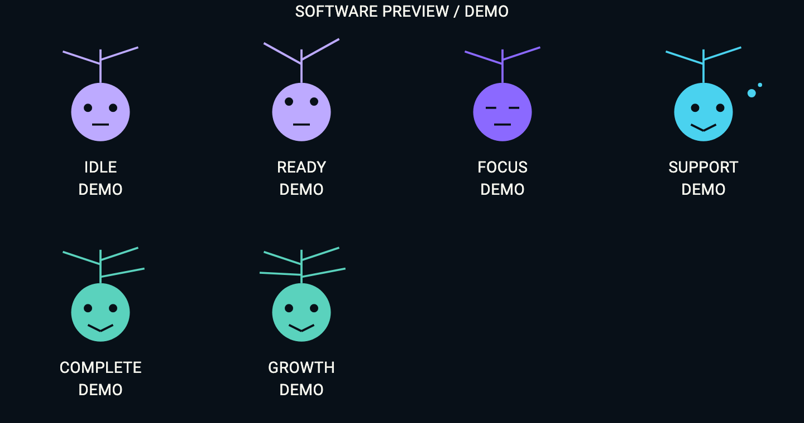
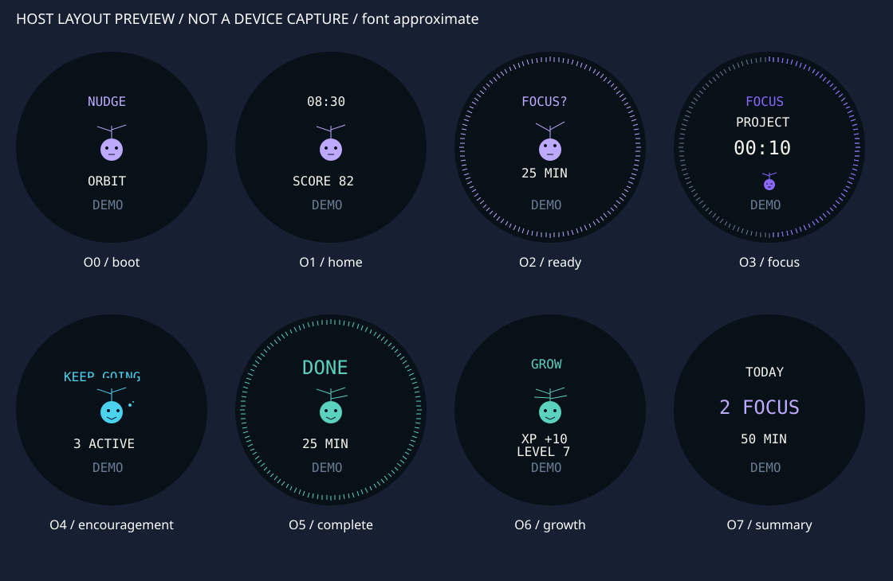
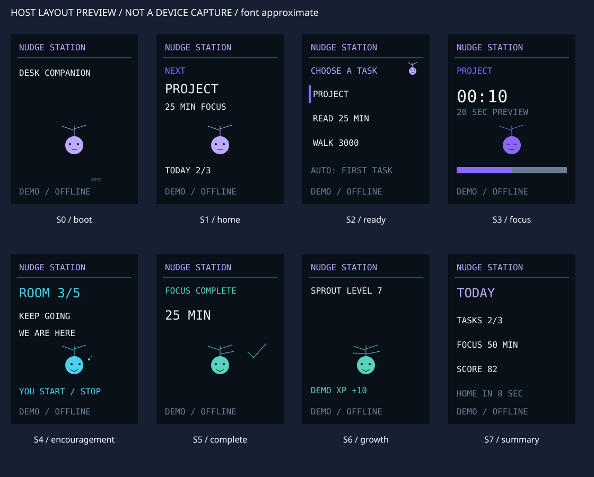

# 07／08：Prototype Controller 與共用視覺

日期：2026-11-19。依使用者指示先完成軟體、達 85 分再送 PR；實機稍後驗收。
來源為固定新版
[07 App／BLE](https://github.com/z1nnz/graduation-project-nudge/blob/9ace911bf892dfb3a451acce7e2ecbeb41904f7d/docs/work-packages/07-optional-app-ble-link.md)、
[08 視覺](https://github.com/z1nnz/graduation-project-nudge/blob/9ace911bf892dfb3a451acce7e2ecbeb41904f7d/docs/work-packages/08-character-and-visual-system.md)。

**本輪是軟體交付，不是整包實機通過。BLE 預設 OFF，Station pinmap 仍未配置，P1 也維持 OFF。**
07 是 P2，兩台 P0-B／視覺／10 次重播未實機通過前，不啟用。沒有因使用者要求先做程式而將前置改成通過。

## 查重與依賴

查全部 24 個 PR、25 個分支、Issue 與 #18／#24 留言、main 與現有 source，沒有新版 07／08 的專屬交付或完成紀錄。
#8／#14／#15 是正式 BLE 基礎；#23／#24 有部分 palette 與兩套幾何角色，但沒有六姿態的共用 source、獨立 Demo Controller 或新 Demo service。
這些可重用的基礎不算整包已完成。無法排除別人尚未推送的本機工作。

從最新 main 建分支，再沿用未合併 #24（含 #23／#21），沒有覆寫別人分支。
建議 z1nnz 先審 #21、#23、#24，再看本輪相對 #24 的新增內容；PR base 保持 main，不強推、不改 workflow、不自行合併。

## 交付入口

- [07 逐項驗收／協定／操作](package07-acceptance.md)
- [08 逐項驗收／姿態／動畫](package08-acceptance.md)
- [自評與扣分](self-review.md)
- [實機待補紀錄](evidence.json)
- [唯一協定與角色資料](../../../shared/demo_contract.json)
- [原始碼／建置／硬體設定](../../../firmware/nudge_competition_demo/README.md)

App 入口：`lib/main_demo_controller.dart`；不執行正式 AppState／帳號／通知／Firebase 的 Dart 啟動。
沿用既有 Android app 的 plugin 與打包相依，沒有宣稱 APK 不包含既有 Firebase plugin。
Android 才有原生 BLE profile；iOS／Web 可看原型與備援說明，不宣稱有 iOS BLE。
本輪成功建置獨立 Web 預覽並在本機瀏覽器確認兩卡、三按鈕、未驗收時停用、角色預覽及 DEMO。
這是軟體畫面驗證，不是手機掃描／操作影片。

## 三端軟體預覽

此圖來自實際 Flutter CustomPainter 的 widget 渲染；文字使用本機 Flutter SDK 的 Roboto 作測試用字型，沒有將字型檔加入專案。
不是手機截圖、連線成功或真實裝置回報。App 的預覽明示 DEMO；實際連線需收到同一指定裝置的有效 Demo state 才開控制。

兩張 SVG 由實際 C++ Painter 產生；字型近似。可核對六姿態、相同 Scene 意義、不同布局與 DEMO，不能證明 30–80cm 可讀或實物色彩。
App 靜態角色預覽與兩台共用同一 mark 資料；裝置只在自己的角色區塊更新，不每幀清整屏。

本輪沒有新增採購、接線、upload、真實帳號／房間／健康資料、Cloud Receipt、正式 XP、OTA 或裝置指派。
影片、接法、手機／裝置型號與版本等實測資料維持 null／false；詳見逐項表格。
