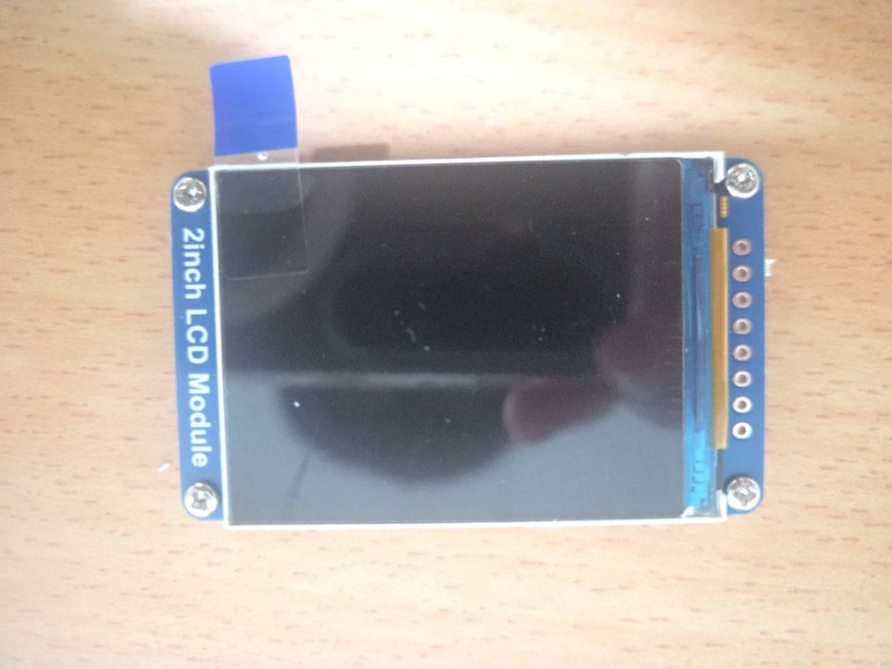
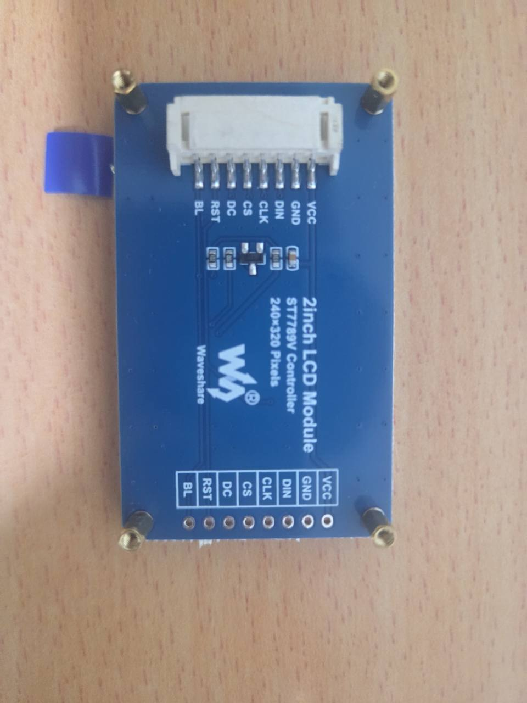

# Station｜開發前零件卡

日期：2026-11-14。任務：`DEMO-02`（P0-A）；負責：roy。
範圍遵循 [package 00](https://github.com/z1nnz/graduation-project-nudge/blob/9ace911bf892dfb3a451acce7e2ecbeb41904f7d/docs/work-packages/00-scope-reset.md)。
本卡完成照片與來源盤點，實際 LCD→XIAO 接線尚未確認。

| Package 01 必填欄位 | 已知結果 |
| --- | --- |
| 裝置 | Nudge Station 桌面裝置；「方屏」為產品類別，實際面板為長方形 |
| ESP32 板上印字 | [獨立主控背面](evidence/station/2026-11-08-mcu-back-original.jpg)可見 XIAO ESP32S3；先前標作主控正面的[原圖](evidence/station/2026-11-08-mcu-front-original.jpg)可讀 `Model: XIAO-ESP32-S3`，但它位於圓屏組件上，不能當作已確認第二塊獨立主控的證據 |
| 螢幕正面照片 | [正面原圖](evidence/station/2026-11-08-display-front-original.jpg)，未見畫面 |
| 螢幕背面照片 | [背面原圖](evidence/station/2026-11-08-display-back-original.jpg)，品牌、driver、解析度與八訊號可讀 |
| 螢幕或包裝型號 | Waveshare `2inch LCD Module`；[包裝 SKU 17344](evidence/station/2026-11-08-package-original.jpg) |
| 商品／原廠頁 | [Waveshare 官方產品文件](https://docs.waveshare.net/2inch_LCD_Module/)、[商品頁](https://www.waveshare.com/product/2inch-lcd-module.htm)、[XIAO ESP32S3 官方 pin map](https://wiki.seeedstudio.com/xiao_esp32s3_getting_started/#hardware-overview) |
| 目前如何連接 | 僅有獨立 LCD、主控背面及[線束兩端照片](evidence/station/2026-11-08-display-cable-original.jpg)；沒有 LCD 與 XIAO 成功連接照片。歷史使用者紀錄採電腦 USB 供電，尚無成功操作證據 |
| 目前已觀察到的畫面 | 僅螢幕外觀；無五色／Nudge 畫面，不宣稱正常或故障 |
| USB 線可否成功燒錄 | 未驗證；未取得資料線型號、單機 port、upload log 或 firmware hash |
| 已購買可選周邊 | seesaw 旋鈕、SparkFun VEML7700、Qwiic Buzzer、10-WS2813 Mini LED、SN74AHCT125N；照片與限制見下表，P0-A 均不接入 |
| 不確定事項 | 主控個別實物對應、LCD PCB revision、ST7789 精確尾碼、現有接頭／已焊排針可用性、線色與逐訊號對應、BL 控制接法 |

## 螢幕身分：可核對，不猜接法

| 欄位 | 實物或原廠依據 |
| --- | --- |
| 解析度 | 背面 `240×320 Pixels`，與原廠一致；不使用 240×240 圓屏版面 |
| Driver | 背面 `ST7789 Controller`；中文原廠文件為 ST7789V，英文產品資料曾列 ST7789VW；實物 IC 尾碼未辨識，保留差異 |
| 介面 | 原廠四線 SPI；背面 VCC／GND／DIN／CLK／CS／DC／RST／BL |
| VCC 規格 | 原廠列模組輸入 3.3V／5V；這不代表所有訊號腳可接受 5V |
| 原廠範例 | 原廠提供 Arduino UNO、STM32、Raspberry Pi 範例；未找到對應這組 XIAO＋17344 的原廠現成插接例，不能照搬 UNO pin number 或 Orbit driver |
| Library | [Waveshare 範例與資料](https://docs.waveshare.net/2inch_LCD_Module/Resources-And-Documents/)為後續 STA-01 起點；尚未選定或驗證 XIAO 移植的 library／版本 |

DIN 是 MOSI、CLK 是 SPI 時脈、CS 是低有效片選、DC 是命令／資料、RST 是重設、
BL 是背光控制。這些是 LCD 訊號名稱，不是 MCU GPIO 配置表；線束兩端視角與線色
不能用來推定逐線接法。package 01 的 C 級處理適用此連接路徑：先核對官方／店家
資料及實物標示，不帶電改線，也不以購買電表或焊接作本次必做前置。

## 既有選配周邊：只盤點，不實作 P1

| 物件 | 原圖與來源 | 未確認與處理 |
| --- | --- | --- |
| Adafruit I²C seesaw 旋鈕 | [正面](evidence/station/2026-11-08-encoder-front-original.jpg)、[背面](evidence/station/2026-11-08-encoder-back-original.jpg)、[原廠系列文件](https://learn.adafruit.com/adafruit-i2c-qt-rotary-encoder) | 精確採購 SKU／revision、線材未確認；已有旋鈕不等於確定預焊 SKU，P0-A 不接 |
| SparkFun Ambient Light Sensor VEML7700 | [合照左下 SEN-29211](evidence/station/2026-11-08-accessories-ambient-original.jpg)、[原廠文件](https://docs.sparkfun.com/SparkFun_Ambient_Light_Sensor-VEML7700/hardware_overview/) | 包裝及外觀相符，讀值／接線未測；失效時固定亮度，不顯示精確 lux |
| SparkFun Qwiic Buzzer | [元件面](evidence/station/2026-11-08-buzzer-front-package-original.jpg)、[背面／BOB-24474 包裝](evidence/station/2026-11-08-buzzer-back-package-original.jpg)、[原廠文件](https://docs.sparkfun.com/SparkFun_Qwiic_Buzzer/single_page/) | 接線與功能未測，失效時靜音；合照重複出現的同一板不另計數 |
| RGB LED Stick（10-WS2813 Mini）v1.0 | [正面](evidence/station/2026-11-08-led-front-original.jpg)、[背面](evidence/station/2026-11-08-led-back-original.jpg)、[原廠文件](https://wiki.seeedstudio.com/Grove-RGB_LED_Stick-10-WS2813_Mini/) | 10 顆 LED 是光輸出，不是光感；未驗證配線與發光，候選轉換接法屬 D 級並延後 |
| SN74AHCT125N | [文字面](evidence/station/2026-11-08-ahct125-marking-original.jpg) | 既有辨讀紀錄為此型號，照片較低對比；未驗證完整轉換電路，不能由有 IC 推定 LED 已可接 |
| MB-102 與盒裝跳線 | [配件合照](evidence/station/2026-11-08-accessories-ambient-original.jpg) | 可確認存在，沒有已成功接線紀錄 |

## 已保存原圖

原圖收到日期 2026-11-08，逐檔雜湊見 [manifest](evidence/manifest.json)。
主控照片的舊分類已保留檔名，並在 manifest 更正觀察；不重新計為兩塊已驗證主控。

## 下一份最小證據

由裝置持有人對應 Station 的獨立主控，確認 LCD 八訊號到主控的實際現成接法、
單一 USB port 與資料線後，保存接法照片、library 版本、編譯／燒錄 log 和五色影片。
本 PR 沒有程式、GPIO 表、編譯結果或上電指令；使用者指定實機稍後驗收。
零件卡文件可供審查，`DEMO-02` 的實際接法與 `STA-01` 實機驗收仍待補。
