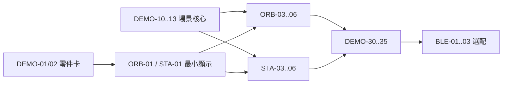

# 11｜可直接認領的競賽 Demo Issue Backlog

## 使用方法

每個 Issue 單獨開分支與 PR。P0 全部完成前，不認領 P2。估時是專注工作時間，
不是承諾；阻塞半天需回報。

## Wave 0｜範圍與零件

| ID | 優先 | 預設負責 | 任務 | 驗收 |
| --- | --- | --- | --- | --- |
| DEMO-00 | P0 | 全員 | 確認舊 32 包作廢 | README、群組訊息與新 ZIP 都指向新版 |
| DEMO-01 | P0 | Orbit | 建立 Orbit 零件卡 | 圓屏正反面、型號、插接方向、USB 燒錄紀錄 |
| DEMO-02 | P0 | Station | 建立 Station 零件卡 | 方屏正反面、商品頁、driver、解析度、連接方式 |
| DEMO-03 | P0 | 整合者 | 固定 Demo 資料與 3 分鐘腳本 | 兩台使用相同人物、任務、房間與 XP |

## Wave 1｜共用場景

| ID | 優先 | 預設負責 | 任務 | 驗收 |
| --- | --- | --- | --- | --- |
| DEMO-10 | P0 | 整合者／先完成者 | 建立 DemoScene 與 DemoData | host test 覆蓋 8 幕 |
| DEMO-11 | P0 | 同上 | 自動時間軸 | 無輸入可走完整流程 |
| DEMO-12 | P0 | 同上 | Next／Restart API | 任一 Scene 可重新開始 |
| DEMO-13 | P0 | 同上 | Optional adapter 失敗策略 | 周邊 begin 失敗仍進畫面 |

## Wave 2A｜Orbit

| ID | 優先 | 預設負責 | 任務 | 驗收 |
| --- | --- | --- | --- | --- |
| ORB-01 | P0 | johnsnow | 圓屏整屏色彩與方向 | 五色輪播＋影片 |
| ORB-02 | P0 | johnsnow | 字型與圓形安全區 | 中心、外圈、三字級可讀 |
| ORB-03 | P0 | johnsnow | Boot／Home／Ready | serial 切換無殘影 |
| ORB-04 | P0 | johnsnow | Focus 圓形進度 | 15–20 秒展示、不卡輸入 |
| ORB-05 | P0 | johnsnow | Support／Complete／Growth／Summary | 8 幕完整 |
| ORB-06 | P0 | johnsnow | Orbit 自動播放與 Restart | 10 輪＋10 次 |
| ORB-07 | P1 | johnsnow | 現有觸控／按鍵 | 短按 Next、長按 Restart |
| ORB-08 | P1 | johnsnow | 精簡動畫 | Boot、Focus、Complete 三種 |

## Wave 2B｜Station

| ID | 優先 | 預設負責 | 任務 | 驗收 |
| --- | --- | --- | --- | --- |
| STA-01 | P0 | roy | 方屏官方最小範例 | 五色輪播＋影片 |
| STA-02 | P0 | roy | 方屏字型、rotation、版面格線 | 三字級可讀 |
| STA-03 | P0 | roy | Boot／Home／Task Select | 三任務固定資料 |
| STA-04 | P0 | roy | Focus 畫面 | 進度、任務、角色 |
| STA-05 | P0 | roy | Support／Complete／Growth／Summary | 8 幕完整 |
| STA-06 | P0 | roy | Station 自動播放與 Restart | 10 輪＋10 次 |
| STA-07 | P1 | roy | 現有旋鈕／按鍵 | 選任務、確認、Restart |
| STA-08 | P1 | roy | 現有 LED 完成效果 | 拔除後仍可 P0 |
| STA-09 | P1 | roy | 現有光感／蜂鳴器 | 固定亮度 fallback／靜音 |

## Wave 3｜一致性與驗收

| ID | 優先 | 預設負責 | 任務 | 驗收 |
| --- | --- | --- | --- | --- |
| DEMO-30 | P0 | 整合者 | 共用色彩與角色姿態 | 同 Scene 同意義 |
| DEMO-31 | P0 | 全員 | 固定資料加入 DEMO 標記 | 兩台可辨認 |
| DEMO-32 | P0 | 全員 | 兩台斷網重播 | 各 10 輪 |
| DEMO-33 | P0 | 全員 | 3 分鐘一鏡到底 | 影片與計時 |
| DEMO-34 | P0 | 整合者 | 保存 binary 與 build id | 可在另一台電腦找到並燒錄 |
| DEMO-35 | P0 | 全員 | 比賽日故障排練 | 不開 App／拔 P1 仍可說明 |

## Wave 4｜選配

| ID | 優先 | 預設負責 | 任務 | 驗收 |
| --- | --- | --- | --- | --- |
| BLE-01 | P2 | 有餘力者 | App 掃描 Demo 裝置 | 真實手機影片 |
| BLE-02 | P2 | 有餘力者 | App 傳 Next／Restart | 各 10 次 |
| BLE-03 | P2 | 有餘力者 | 斷線降級 | 裝置自動 Demo 不停止 |

## 依賴



## Issue 模板

```md
## 目標

## 裝置與零件

## Scope
- In:
- Out:

## 實作步驟

## 驗收
- [ ] compile
- [ ] physical upload
- [ ] physical display/input
- [ ] fallback
- [ ] video

## 交付
- Branch:
- Commit:
- Video:
- Binary:
- Known limitations:
```

## 關閉規則

Issue 只有在影片與版本都存在時才關閉。沒有實機證據可標
`source-complete`，但不得標 `device-verified`。

