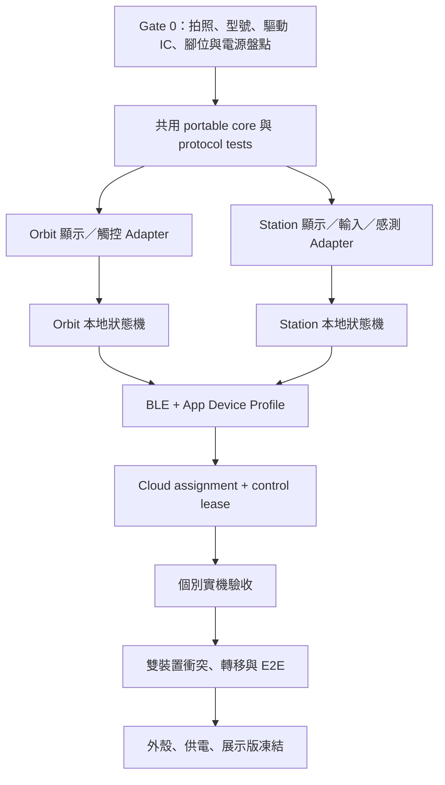

# 13｜Nudge 雙裝置總體計畫

## 決策摘要

兩套硬體不做成同一產品的「圓屏版／方屏版」，而是共用 Nudge 活動協定、App、
Cloud Ledger 與角色資料的兩個不同使用情境：

| 產品 | 暫定名稱 | 核心情境 | 主要價值 |
| --- | --- | --- | --- |
| 圓形螢幕 | **Nudge Orbit** | 穿戴式／隨身個人夥伴 | 隨時看時間、角色、下一步，快速開始與回應 |
| 方形螢幕 | **Nudge Station** | 桌上專注中樞 | 完整資訊、旋鈕控制、環境感測、燈光與聲音回饋 |

Orbit 是低資訊密度、低摩擦、個人化裝置；Station 是高可視性、可操作、可展示的
桌面裝置。兩者不能同時控制同一個 active session；App／Cloud 必須知道目前哪一
台取得 session control lease。

## 為什麼要這樣分

### 圓形螢幕適合 Orbit

- 圓形 UI 天然適合時間、環形進度、角色表情與少量狀態。
- 可視範圍小，不適合塞房間清單、感測器數據和完整設定。
- Seeed Round Display 本身已有觸控與 RTC，可把外接周邊降到最低。
- 若未來加入受保護電池與外殼，可形成穿戴概念；第一階段仍先用 USB 驗證，不能
  在電池安全未完成前直接宣稱可日常配戴。

### 方形螢幕適合 Station

- 方形版面可同時顯示倒數、房間、角色、同步狀態與感測器狀態。
- 桌上裝置有空間容納旋鈕、LED 導光、環境光採光窗與蜂鳴器。
- 長時間 USB 供電比穿戴裝置更適合燈條、亮度調整與展示。
- 原先的完整 Focus Companion 功能可移到 Station，不再被圓屏腳位與空間限制。

## 兩套系統的責任分界

| 能力 | Orbit | Station | 正式真相 |
| --- | --- | --- | --- |
| 時間／角色／下一步 | 主要 | 顯示 | App 提供安全 snapshot |
| 快速開始／暫停／完成 | 主要 | 主要 | Cloud Activity Session |
| 房間選擇 | 最多一個最近情境 | 最多三個已授權房間 | DeviceAssignment + Membership |
| 環境光調光 | 選配／內部未確認 | 主要，VEML7700 | 裝置本地 presentation |
| LED 狀態燈 | 不外接或極簡 | 主要，WS2813 + 導光 | 裝置本地 presentation |
| 蜂鳴器 | 預設不裝 | 主要，可靜音 | App sound preference |
| 健康數據 | 只顯示 App 已同步摘要 | 不量測健康，只顯示安全摘要 | Health Adapter + Cloud Ledger |
| coin／XP／關係成果 | 只能顯示 | 只能顯示 | Cloud Reward/Outcome |
| 實體活動證明 | 不宣稱 | 不宣稱 | v1 仍是 App-mediated trust |

## 共同產品原則

1. 裝置控制的是被指派使用者自己的活動，不替家人、孩子、團體成員操作。
2. BLE payload 不攜帶可信 actor/role；App 依 Cloud DeviceAssignment 補上身分與
   occurrence-time room scope。
3. 事件先寫裝置 journal，App 耐久寫入 outbox 後才 ACK，Cloud 以 stable event ID
   去重。
4. 角色、coin、XP、家庭樹、團體星球只由 Cloud 正式資料衍生。
5. Orbit 和 Station 顯示的文案可以不同，但 phase、event、revision、錯誤語意相同。
6. 每台裝置有唯一 `deviceId`、`hardwareProfile`、`firmwareVersion` 與 capability set。

## 開發階段與依賴



## Gate 0：硬體身分卡（任何接線前必做）

每塊板建立一份 `docs/hardware/inventory/<device>.md`：

```text
產品角色：Orbit / Station
主控完整型號與正反面絲印：
USB VID/PID、serial port：
螢幕商品連結、驅動 IC、解析度、觸控 IC：
螢幕供電電壓、邏輯電壓：
原廠 pin map／原理圖連結：
板上按鈕、RTC、IMU、microSD、充電 IC：
外接感測器完整型號、位址、電壓：
電源與電池型號：
正面／背面／接頭近照：
可逆的第一個 smoke test：
```

方形螢幕的型號、驅動 IC、解析度和電壓尚未在專案文件中被確認。完成身分卡前，
不得把 Orbit 的 D1/D3/D6/D8/D9/D10 或任何網路範例腳位套到方屏。

## 里程碑

### M0｜硬體已識別

- 兩顆 ESP32 和兩片螢幕都有照片、型號、官方文件和量測後電源資訊。
- 每條線都有來源與目的標記，沒有未確認 5V 直接進 3.3V GPIO。

### M1｜兩片螢幕獨立可觀察

- 各自的最小韌體可冷開機 10 次，顯示色塊、方向標記、文字與 serial marker。
- 成功只代表 display Adapter；尚未代表 BLE、Ledger 或完整產品。

### M2｜共用核心可跑

- configure/start/pause/resume/complete、計時、journal、queue-head ACK、context revision
  在 native host tests 通過；硬體 Adapter 不含業務規則。

### M3｜個別產品可用

- Orbit 完成時間／角色／快速活動／觸控或確認輸入。
- Station 完成方屏／旋鈕／環境光／LED／蜂鳴器／房間選擇。

### M4｜跨 App 與 Cloud

- 兩台裝置各自完成 Android → BLE → App outbox → Cloud Receipt → App/Web outcome。
- 斷線、重開、重送不重複 reward；撤銷 assignment 後 fail closed。

### M5｜雙裝置安全共存

- 同帳號可擁有兩台，但同一 active session 只有一個 control lease。
- 從 Orbit 轉移到 Station 需要 App 明確確認；舊裝置轉 read-only/idle。
- 每台 queue 各自清空後才能轉移帳號或變更 room scope。

## 非目標

- Orbit v1 不量測心率、血氧、醫療健康或自行計算步數。
- Station v1 不做相機、麥克風、人體監控或未經同意的在席紀錄。
- 不在兩套韌體複製 Cloud 權限、reward 或 Membership 規則。
- 不在電池保護、熱測試、外殼和充電驗收前稱 Orbit 為可日常配戴產品。
