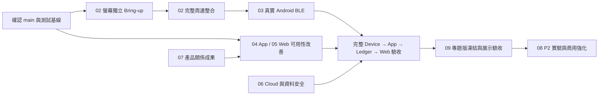

# Nudge 後續開發工作包

- 基準版本：`origin/main` @ `c37c6ab`
- 建立日期：2026-10-25
- 適用範圍：Flutter App、Web Dashboard、Cloud、資料契約、實體裝置韌體與驗收
- 使用對象：專題組員、外部協作者、AI coding agent、最後審查與合併者

這個目錄不是願望清單，而是一組可分支、可測試、可驗收的開發工作包。每份
文件都說明目前基線、要解決的問題、建議修改位置、實作順序、測試方式、驗收
證據與明確不做的範圍。執行者一次只領取一個可獨立驗收的切片，不得把整份
工作包塞入同一個 PR。

## 先讀哪一份

1. [`00-author-guide.md`](00-author-guide.md)：所有寫作者與開發者的共同規則。
2. [`01-current-state-and-priorities.md`](01-current-state-and-priorities.md)：先確認什麼
   已完成、什麼只完成程式碼、什麼仍未驗收。
3. 再依任務選擇下列工作包。

| 編號 | 工作包 | 主要成果 | 優先級 |
| --- | --- | --- | --- |
| 02 | [韌體與硬體 Bring-up](02-firmware-and-hardware-bringup.md) | 螢幕、旋鈕、燈條、環境光、蜂鳴器可重現的實機證據 | P0 |
| 03 | [裝置協定與 Android BLE](03-device-protocol-and-android-ble.md) | 真實手機到裝置、App outbox、Cloud Ledger 的可靠閉環 | P0 |
| 04 | [Flutter App 改善](04-flutter-app-improvements.md) | 清楚的首次使用、裝置設定、關係切換與失敗復原 | P1 |
| 05 | [Web 與後台改善](05-web-and-admin-improvements.md) | 權限導覽、角色上架、裝置指派與營運稽核 | P1 |
| 06 | [Cloud、Ledger 與資料安全](06-cloud-ledger-security-and-data.md) | 統一真相、稽核、遷移與未來裝置可信身分 | P1/P2 |
| 07 | [家庭、團體、自律房與角色成果](07-relationships-rooms-and-characters.md) | 讓社群功能有誘因但不奪走個人自主權 | P1 |
| 08 | [新功能與產品實驗](08-new-features-and-experiments.md) | 有特色且可量測的下一批功能，不先堆大型功能 | P2 |
| 09 | [品質、發布與驗收](09-quality-release-and-acceptance.md) | 自動測試、實機矩陣、證據、回復與發布門檻 | P0 |
| 10 | [交付模板](10-delivery-templates.md) | Issue、PR、驗收紀錄與交接的可複製格式 | 共用 |

## 建議執行順序

韌體 Bring-up、App/Web 體驗改善可以平行進行，但「嵌入式系統已整合」必須
等真實 Android 手機、實體裝置、App outbox、Cloud Ledger、Web/房間/角色成果
整條鏈都有證據後才能宣稱完成。

## 全系統不可破壞的規則

- Cloud Activity Ledger 是活動、房間貢獻與獎勵的正式真相。
- App、Web、韌體不得直接增加自律幣、角色 XP 或正式成果。
- 家長不能替孩子控制活動；管理者不能替成員開始、暫停或完成活動。
- 同一活動可在多個獲授權情境中顯示，但只能結算一次個人獎勵。
- 家庭／團體角色取自有效 `relationship_memberships`，不能從本機角色選項猜測。
- 只有完整且已發布的三階角色鏈可進入圖鑑；商城只販售第一階。
- 裝置收到 GATT write 不代表已持久化；必須回報相同 `contextRevision`。
- 裝置事件只有先耐久寫入 App Ledger outbox 才能 ACK；重送不得重複計分。
- 不把 Simulator、編譯成功或燒錄成功寫成實體顯示／BLE／Cloud 驗收成功。
- 不提交 Token、service account、`.env`、真實使用者資料或可識別健康資料。

## 狀態標籤

每個 Issue、PR 與驗收紀錄都使用同一套標籤：

- `implemented`：程式碼已存在且自動測試通過。
- `source-verified`：介面與行為有程式碼／測試證據，但尚未在目標環境操作。
- `device-verified`：指定實體裝置與版本已完成重現測試。
- `production-verified`：已在正式 Cloud／真實帳號完成並保存清理結果。
- `deferred`：刻意不納入目前里程碑，並有清楚理由。
- `blocked`：缺少硬體、帳號、權限或外部服務，且已列出解除條件。

不要用「完成」同時代表以上不同層級。
