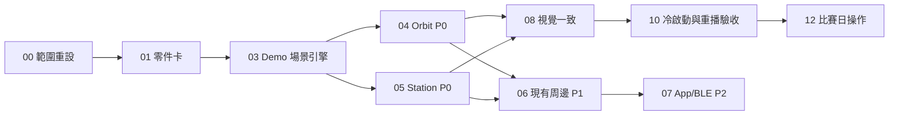

# Nudge 雙裝置競賽 Demo 工作包

- 版本：Competition Demo Edition v1
- 更新日期：2026-11-09
- 適用對象：兩位嵌入式組員、整合者、最後合併者與現場展示者
- 實體目標：Nudge Orbit 圓形裝置與 Nudge Station 方形裝置
- 唯一成功標準：教授能在兩台實體機上清楚看見 Nudge 的畫面、理解用途，並完成至少一次可重複的互動

> 本版完全取代先前的 32 份「雙裝置完整工作包」。舊 ZIP
> `Nudge-MD-雙裝置完整工作包-2026-11-04-v2.zip` 已作廢，不再作為分工、
> 採購或驗收依據。

## 這次到底要做什麼

只做專題競賽可展示的原型，不做量產裝置。兩台 XIAO ESP32S3 必須各自透過
USB 供電並顯示一套完整的 Nudge 情境：

- **Nudge Orbit**：圓形螢幕，像穿戴型自律夥伴；展示時間、專注環、提醒、
  任務完成與角色成長。
- **Nudge Station**：方形螢幕，像桌面自律中樞；展示今日任務、專注倒數、
  自律房／家庭鼓勵、角色成果與現有 LED／感測器效果。

App、BLE、Cloud、Web 不是硬體 Demo 的前置條件。能可靠連動才展示；沒有完成
就使用裝置內建的確定性 Demo 資料，並在簡報中稱為「原型展示資料」。

## 優先級

| 優先級 | 意義 | 是否影響上台 |
| --- | --- | --- |
| P0 | 兩台螢幕能開機、顯示、切換完整故事且可反覆重播 | 必須完成 |
| P1 | 使用已購買的按鍵、旋鈕、LED、光感或蜂鳴器增加互動 | 有時間才做 |
| P2 | App／BLE 觸發、雙裝置同步或真實 Cloud 資料 | 不得阻擋 P0 |

## 文件地圖

| 編號 | 文件 | 交付成果 |
| --- | --- | --- |
| 00 | [範圍重設](00-scope-reset.md) | 統一什麼要做、什麼不做、什麼不能宣稱 |
| 01 | [現有零件與限制](01-demo-parts-and-constraints.md) | 只用已購買零件，建立不猜接線的零件卡 |
| 02 | [展示故事與評審流程](02-demo-story-and-judge-flow.md) | 3 分鐘可重播的雙裝置故事 |
| 03 | [Demo 韌體架構](03-demo-firmware-architecture.md) | 共用場景引擎、Orbit／Station 畫面 Adapter |
| 04 | [Orbit 工作包](04-orbit-round-display-work-package.md) | 圓形螢幕的畫面、互動、測試與證據 |
| 05 | [Station 工作包](05-station-square-display-work-package.md) | 方形螢幕的畫面、互動、測試與證據 |
| 06 | [既有輸入與周邊](06-existing-input-led-sensor-work-package.md) | 不加購的互動增強與安全降級 |
| 07 | [App／BLE 選配連動](07-optional-app-ble-link.md) | 不阻擋展示的單向觸發或明確放棄 |
| 08 | [角色與視覺語言](08-character-and-visual-system.md) | 兩台裝置看起來屬於同一個 Nudge 世界 |
| 09 | [兩人分工與 Git 流程](09-two-person-team-and-git-plan.md) | 誰做哪台、如何開分支、如何交 PR |
| 10 | [測試與現場排練](10-demo-test-rehearsal-acceptance.md) | 3 次冷啟動、10 次重播、斷網展示 |
| 11 | [可直接認領的 Issue](11-demo-issue-backlog.md) | 依依賴排序的細粒度任務 |
| 12 | [比賽日操作手冊](12-competition-day-runbook.md) | 接線、燒錄、備援與口頭說法 |
| 13 | [交付與證據模板](13-delivery-evidence-template.md) | PR、影片、照片、版本和未完成項目格式 |

## 建議執行順序

## 全隊共同規則

1. 不再購買新工具或新零件，除非專題負責人另行明確同意。
2. 沒有萬用電表、烙鐵、洞洞板也不影響 P0；P0 使用現成接頭、已焊排針與 USB。
3. 不知道型號或接線時，不猜、不硬插、不帶電改線；先拍清楚零件正反面與標示。
4. Demo 韌體必須離線可跑，不能因 Wi-Fi、Firebase、手機或登入失敗而黑屏。
5. 可以使用固定展示資料，但畫面或簡報必須說是 Prototype／Demo。
6. 尚未真正連動的 App、家庭、團體、自律房、角色成果，不得宣稱已由實體裝置同步。
7. 每台裝置都要有自動展示模式；即使外接按鍵或感測器失效，仍能完成整段展示。
8. 編譯成功不等於實機完成；必須交付能看到裝置與畫面切換的連續影片。

## 最小完成定義

- Orbit USB 上電後 10 秒內進入畫面，能走完至少 6 個畫面狀態。
- Station USB 上電後 10 秒內進入畫面，能走完至少 6 個畫面狀態。
- 每台可用同一個操作重新開始 Demo，不必重新燒錄。
- 兩台裝置在沒有網路、沒有手機的情況下仍可展示。
- 連續重播 10 次，不出現白屏、卡死或需要改接線。
- 保存韌體 commit、PlatformIO build log、兩段實機影片與比賽日可直接使用的 binary。

## 不在本版範圍

- 量產、認證、電池、充電、OTA、加密裝置身分。
- 萬用電表、烙鐵、洞洞板與外殼內永久配線。
- 24 小時壓力、溫升、峰值電流與正式可靠度測試。
- 完整 Device → App → Cloud Ledger → Web 正式閉環。
- 為了用完所有零件而硬塞感測器。
- 因為某個 P1／P2 功能失敗而推遲 P0 螢幕展示。
